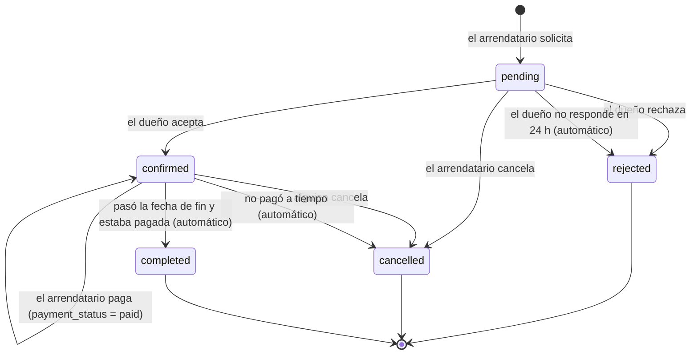
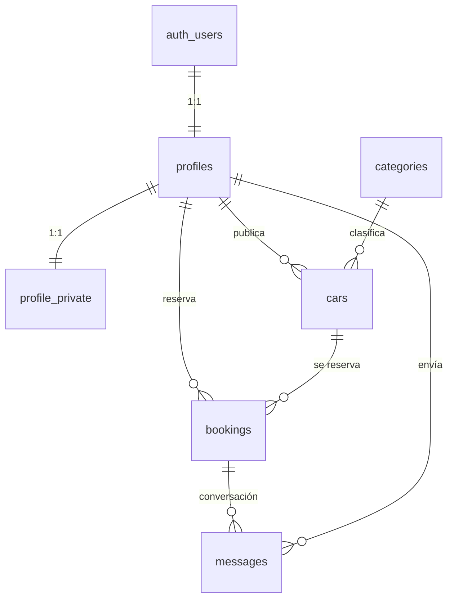
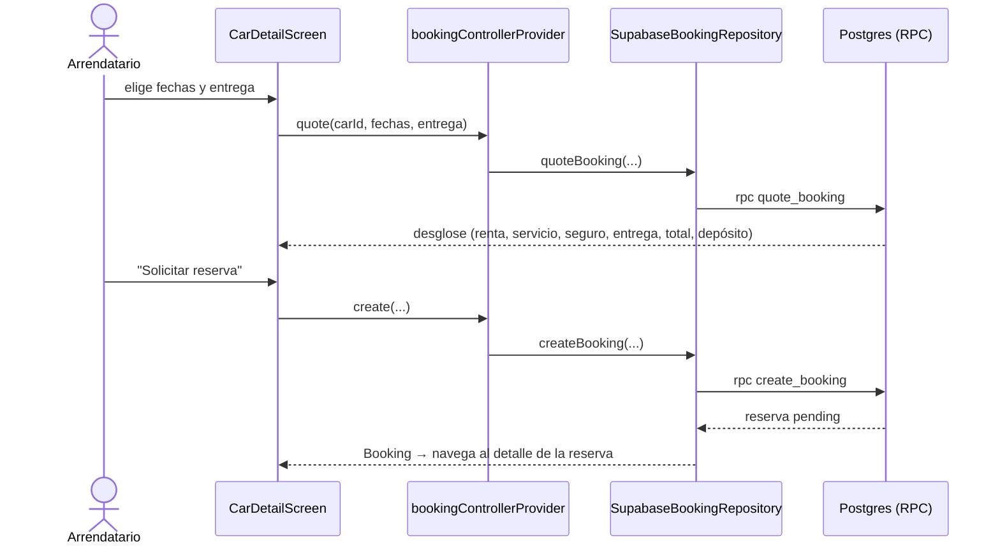

# Drivo — Contexto del MVP

> Fuente de verdad del proyecto Drivo-Flutter. Si cambias una regla, una tabla, una política RLS o la estructura, actualiza este archivo en el mismo PR.
>
> Última revisión: 2026-10-29.

## Índice

1. [Qué es Drivo](#1-qué-es-drivo)
2. [Qué es este repo](#2-qué-es-este-repo)
3. [Decisiones del MVP](#3-decisiones-del-mvp)
4. [Alcance del MVP](#4-alcance-del-mvp)
5. [Reglas de negocio](#5-reglas-de-negocio)
6. [Base de datos](#6-base-de-datos-supabase-drivo-db-dummy)
7. [Seguridad y RLS](#7-seguridad-y-rls)
8. [Arquitectura de la app](#8-arquitectura-de-la-app-flutter)
9. [Módulos](#9-módulos)
10. [Pantallas y navegación](#10-pantallas-y-navegación)
11. [Tema visual](#11-tema-visual)
12. [Configuración y entorno](#12-configuración-y-entorno)
13. [Estado actual, brechas y tareas](#13-estado-actual-brechas-y-tareas)
14. [Decisiones complementarias](#14-decisiones-complementarias)
15. [Fuentes](#15-fuentes)

---

## 1. Qué es Drivo

Drivo es un **marketplace salvadoreño de alquiler de autos entre particulares**, parecido a Turo. No tiene flota ni oficinas: conecta a dueños de autos que los publican con personas que necesitan un carro por pocos días.

- **Promesa de marca:** "seguridad, calidad y precios sin sorpresas", con soporte 24/7 y cobertura en cada viaje.
- **Roles:** arrendatario (`renter`), anfitrión o dueño (`owner`) y ambos (`both`).
- **Mercado inicial:** El Salvador urbano (San Salvador, Santa Elena, Colonia Escalón, Santa Tecla).
- **Evidencia:** 47 pre-registros reales entre abril y septiembre de 2026. El 40% quiere alquilar y publicar, el 34% solo alquilar y el 26% solo publicar. El 96% es de El Salvador.

| Perfil | Quién es | Qué busca |
| --- | --- | --- |
| Principal, "Andrea Mena" | Profesional urbana de 25 a 35 años sin auto | Carro de fin de semana, reservar desde el celular, precio total claro |
| "Carlos Núñez" | Dueño de 30 a 50 años con un auto parado | Ingreso extra, garantía de pago, cobertura por daños |
| "Daniel Girón" | Híbrido de 25 a 40 años | Que su carro se pague solo |
| "José Aldana" (hipótesis) | Salvadoreño en el exterior que visita el país | Auto por 2 a 3 semanas, reservado antes de viajar |

**Retos del producto:** arrancar los dos lados del marketplace a la vez, la confianza (que el auto vuelva sin daños y que el precio final cuadre) y el tiempo de respuesta del dueño.

## 2. Qué es este repo

- **Drivo-Flutter** (`gmolinamendez/Drivo-Flutter`) es un **proyecto académico**: un MVP móvil para **iOS y Android**.
- Toma como guía de estructura y reglas el **repo oficial** de Drivo (`DRIVO-main`, de sebasdr17), una SPA en React 19 + Supabase. El oficial es solo contexto: este repo no lo reemplaza, no comparte su base de datos y no se despliega en su lugar.
- Además del oficial, el MVP incluye lo que el demo de Flutter ya diseñó: desglose de tarifas, checkout simulado, entrega a domicilio y chat.

**Objetivo:** tener una app móvil funcional de punta a punta donde un arrendatario encuentra un auto, lo solicita, el anfitrión lo aprueba, el arrendatario paga (simulado) y ambos coordinan la entrega por chat, todo sobre datos reales en Supabase.

### Resumen del repo oficial (referencia)

| Aspecto | Oficial |
| --- | --- |
| Stack | React 19 + Vite 8, React Router 7, Tailwind 3 (tema oscuro), Zustand, `supabase-js` 2. JavaScript, sin tests |
| Capas | página → hook → store → servicio → modelo (`User`, `Car`, `Booking`) |
| Backend | Supabase: Postgres, Auth, RLS, Storage `car-photos`, Edge Function `pre-register` con Resend |
| Tablas | `profiles`, `categories`, `cars`, `bookings`, `pre_registrations` |
| Auth | Correo y contraseña; pre-registro que crea usuarios baneados hasta el lanzamiento |
| Reserva | `pending` → el dueño acepta (`confirmed`) o rechaza (`cancelled`); total = días × precio |
| No tiene | Pagos, chat, reseñas, tiempo real, tests |
| Documentación | Vault de Obsidian en `docs/` del repo oficial |

## 3. Decisiones del MVP

| Tema | Decisión |
| --- | --- |
| Plataformas | App móvil iOS y Android (Flutter) |
| Backend | Proyecto Supabase **nuevo**: `drivo-db-dummy`. Réplica del esquema oficial. Nunca se usa la BD real del oficial |
| Auth | Solo correo y contraseña. Registro normal, sin pre-registro ni Edge Function |
| Flujo de reserva | Igual al oficial: el arrendatario solicita, **el dueño aprueba** y **después** se paga |
| Pagos | Se ve el proceso completo, pero **simulado**: no hay pasarela real ni cobro |
| Métodos de pago (simulados) | Tarjeta crédito/débito, Chivo Wallet / BTC y Apple Pay |
| Tarifas | Son reglas de negocio (sección 5) |
| Chat | Entra al MVP |
| Tema visual | Tema oscuro del oficial (sección 11) |

## 4. Alcance del MVP

### Entra

| Módulo | Qué hace |
| --- | --- |
| Auth | Registro con nombre, correo, contraseña y rol. Inicio y cierre de sesión. Sesión persistente |
| Catálogo | Lista de autos con filtro por categoría, búsqueda por texto y rango de fechas. Solo muestra autos libres en esas fechas |
| Detalle del auto | Fotos, especificaciones, anfitrión, reglas de uso, tipo de entrega, fechas y cotización |
| Reserva | Crear solicitud `pending` con el desglose de precio calculado en el servidor |
| Pago simulado | Cuando el dueño aprueba, el arrendatario paga con un método simulado y se retiene el depósito simulado |
| Mis reservas | Lista y detalle con estado, código `DRV-SV-#####`, punto de entrega y comprobante |
| Cancelación | Según la regla de 24 horas (sección 5.6) |
| Anfitrión | Activar el modo anfitrión, publicar y editar autos con fotos, pausar un auto, ver y aceptar o rechazar solicitudes |
| Chat | Mensajes en tiempo real entre arrendatario y anfitrión dentro de cada reserva |
| Perfil | Ver y editar nombre, foto, teléfono y licencia de conducir |

### No entra

- Pasarela de pago real, 3DS real o reembolsos reales.
- Login por teléfono, Google o Apple.
- Pre-registro y lista de espera.
- Reseñas y calificaciones escritas por usuarios (el rating solo se muestra desde los datos de prueba).
- Panel de administración.
- Hoja de inspección con fotos de los 4 ángulos y reporte de daños.
- Llamadas, notificaciones push y versión web.

## 5. Reglas de negocio

### 5.1 Roles

| Rol | Puede reservar | Puede publicar autos |
| --- | --- | --- |
| `renter` | Sí | No |
| `owner` | Sí | Sí |
| `both` | Sí | Sí |

- El rol se elige al registrarse; por defecto es `renter`.
- Un `renter` puede activar el modo anfitrión y pasa a `both`. No hay forma de volver atrás.
- **A diferencia del oficial, el rol sí se valida en la BD:** solo `owner` y `both` pueden insertar autos.
- Un usuario no puede reservar su propio auto.

### 5.2 Categorías

Seis categorías fijas: `sedan` (ciudad), `suv` (espacio y aventura), `pickup` (carga y trabajo), `electric`, `luxury` y `sport`.

### 5.3 Fechas y días

- Las fechas son días calendario, sin hora (`date`).
- **Días = fecha de fin − fecha de inicio.** Ejemplo: del 24 al 27 de octubre son 3 días.
- **Mínimo de reserva: 2 días.**
- La fecha de inicio no puede ser anterior a hoy, y la de fin debe ser posterior a la de inicio.
- Dos reservas del mismo auto **se solapan** si sus rangos se cruzan, contando ambos extremos.

### 5.4 Precio

| Concepto | Monto | Cuándo aplica |
| --- | --- | --- |
| Renta | días × precio por día del auto | Siempre |
| Tarifa de servicio Drivo | $12.50 | Fija por reserva |
| Seguro de cobertura total | $18.00 | Fijo por reserva |
| Entrega a domicilio u hotel | $10.00 | Solo si se elige entrega a domicilio |
| **Total a pagar** | suma de lo anterior | |
| Depósito en garantía | $100.00 | Se retiene aparte, **no suma al total**, y se devuelve tras la inspección |

Ejemplo: un auto de $48 por día, 3 días, retiro en punto fijo → 144 + 12.50 + 18 = **$174.50**, más $100 de depósito retenido. Con entrega a domicilio: **$184.50**.

- Moneda: USD.
- **El total lo calcula siempre el servidor** (función `quote_booking`). La app solo lo muestra y nunca envía montos.
- El desglose queda guardado en la reserva. Si después cambia el precio del auto, la reserva conserva el precio original.

### 5.5 Entrega

| Tipo | Costo | Dónde |
| --- | --- | --- |
| `pickup`: punto de encuentro fijo | Gratis | La ubicación del auto que define el anfitrión (ej.: Galerías Escalón, Plaza Futura) |
| `home`: domicilio u hotel | +$10 | Dirección del arrendatario en San Salvador o Santa Tecla |

### 5.6 Ciclo de vida de la reserva



**Estado de la reserva (`status`):**

| Estado | Significado | Bloquea el auto |
| --- | --- | --- |
| `pending` | Solicitud enviada, esperando al dueño | No |
| `confirmed` | El dueño aceptó | **Sí** |
| `rejected` | El dueño rechazó | No |
| `cancelled` | Alguien canceló | No |
| `completed` | El viaje terminó | No |

> El oficial usa `cancelled` también para los rechazos. Aquí se separa `rejected` para que el arrendatario sepa si lo rechazaron o si se canceló.

**Estado del pago (`payment_status`):** `unpaid` → `paid` → `refunded` (si se cancela con derecho a reembolso).

**Estado del depósito (`deposit_status`):** `none` → `held` (al pagar) → `released` (al completar).

**Reglas de transición:**

1. **Crear:** cualquier usuario autenticado, sobre un auto activo que no sea suyo, con fechas válidas, sin solape con reservas `confirmed` y con el perfil completo (teléfono y licencia).
2. **Aceptar:** solo el dueño del auto, solo si está `pending`, y se vuelve a revisar el solape con reservas `confirmed` (puede haber varias `pending` para las mismas fechas). Al aceptar una, las demás `pending` que se solapan pasan a `rejected`.
3. **Rechazar:** solo el dueño, solo si está `pending`.
4. **Plazo del dueño:** tiene **24 horas** desde la solicitud para responder. Si no responde, la reserva pasa sola a `rejected`.
5. **Pagar (simulado):** solo el arrendatario, solo si está `confirmed` y `unpaid`. Pasa a `paid` y el depósito a `held`.
6. **Plazo de pago:** el arrendatario tiene **24 horas** desde que el dueño acepta, o hasta el inicio del viaje si es antes. Si no paga, la reserva pasa sola a `cancelled` y libera el auto.
7. **Cancelar:**
   - El arrendatario puede cancelar una reserva `pending` en cualquier momento.
   - Una reserva `confirmed` se puede cancelar **gratis hasta 24 horas antes de la fecha de inicio**. Si estaba pagada, pasa a `refunded` y el depósito a `released`.
   - Si el arrendatario cancela con **menos de 24 horas**, no se devuelve el total pagado, pero sí el depósito (`released`).
   - El dueño también puede cancelar una `confirmed`; en ese caso el arrendatario siempre recibe reembolso.
8. **Completar:** cuando pasa la fecha de fin, las reservas `confirmed` y `paid` pasan a `completed` y el depósito se libera solo (`released`). Reportar daños queda fuera del MVP.
9. **Tareas automáticas:** los plazos de los puntos 4, 6 y 8 los aplica `run_booking_jobs()`, programada con `pg_cron` cada 15 minutos.

### 5.7 Disponibilidad

- Un auto aparece en el catálogo si su anfitrión lo tiene activo (`is_active = true`) y no tiene reservas `confirmed` que se solapen con las fechas buscadas.
- La BD impide dos reservas `confirmed` que se solapen en el mismo auto (restricción de exclusión, sección 6). En el oficial esto solo se validaba en el cliente.
- **Cambio frente al oficial:** el oficial recalculaba `cars.available` desde el navegador. Aquí la disponibilidad por fechas se calcula en cada consulta, y `is_active` solo indica si el anfitrión tiene el auto publicado o pausado.

### 5.8 Conductor

- Solo puede conducir el titular de la reserva, registrado en Drivo.
- Para reservar se necesita un teléfono (+503) y un número de licencia de conducir VMT SV en el perfil.
- Al recibir el auto debe presentar la licencia física vigente.

### 5.9 Reglas de uso del auto

Cada anfitrión define sus reglas (texto libre en el auto). Las reglas por defecto del demo son: no fumar, mascotas con manta protectora y devolver con el mismo nivel de combustible.

### 5.10 Chat

- Hay una conversación por reserva, entre el arrendatario y el dueño del auto.
- Se abre en cuanto existe la solicitud (`pending`) y sigue abierta hasta que la reserva termina.
- Respuestas rápidas del demo: "Ya estoy aquí", "Retraso de 5 min" y "Listo para inspección".
- Solo texto en el MVP.

### 5.11 Pago simulado

- Se muestra el formulario del método elegido, pero **nunca se guardan números de tarjeta, CVV ni datos sensibles**. La BD solo guarda el método, la fecha y una referencia simulada.
- La app debe dejar claro que es una simulación ("No se realizará ningún cobro real").
- Con tarjeta se muestra un paso de **verificación 3DS simulado** (una pantalla de confirmación del banco ficticia) antes de marcar el pago.
- La pantalla de pago muestra cuánto tiempo queda para pagar (regla 6 de la sección 5.6).

## 6. Base de datos (Supabase `drivo-db-dummy`)

Las migraciones viven en `supabase/migrations/` y se aplican con la CLI de Supabase. Parten del `schema.sql` oficial, con los cambios marcados.



### 6.1 Tablas

**`profiles`** (pública): datos que otros usuarios pueden ver.

| Columna | Tipo | Nota |
| --- | --- | --- |
| `id` | uuid PK → `auth.users` | |
| `name` | text | |
| `role` | text | `renter`, `owner` o `both` |
| `avatar_url` | text | |
| `rating` | numeric(3,2) | Solo lectura para el usuario |
| `review_count` | int | Solo lectura para el usuario |
| `verified` | boolean | Solo lectura para el usuario |
| `created_at` | timestamptz | |

**`profile_private`** (nueva): datos sensibles, solo los ve su dueño.

| Columna | Tipo | Nota |
| --- | --- | --- |
| `id` | uuid PK → `profiles` | |
| `phone` | text | +503 |
| `license_number` | text | Licencia VMT SV |

> **Por qué separarla:** en el oficial `profiles` es legible por todos, así que el teléfono quedaba público. Las políticas RLS filtran filas, no columnas, por eso los datos privados van en otra tabla.

**`categories`**: igual al oficial (`slug`, `label`, `icon`, `description`).

**`cars`**: igual al oficial, con estos cambios:

| Cambio | Motivo |
| --- | --- |
| `available` → `is_active` | Solo indica si el anfitrión lo tiene publicado o pausado |
| + `rules` text | Reglas de uso del anfitrión |
| + `pickup_point` text | Punto de entrega fijo |
| `images` jsonb | Lista de rutas en el bucket `car-photos` |

**`bookings`**: el oficial más el desglose, el pago y la entrega.

| Columna | Tipo | Nota |
| --- | --- | --- |
| `id` | uuid PK | |
| `code` | text único | `DRV-SV-#####`, generado por secuencia |
| `user_id` | uuid → `profiles` | Arrendatario |
| `car_id` | uuid → `cars` | |
| `start_date`, `end_date` | date | |
| `days` | int | Calculado por el servidor |
| `price_per_day` | numeric(12,2) | Copia del precio al reservar |
| `rental_subtotal` | numeric(12,2) | días × precio |
| `service_fee` | numeric(12,2) | 12.50 |
| `insurance_fee` | numeric(12,2) | 18.00 |
| `delivery_fee` | numeric(12,2) | 0 o 10.00 |
| `total_price` | numeric(12,2) | Suma |
| `deposit_amount` | numeric(12,2) | 100.00 |
| `delivery_type` | text | `pickup` o `home` |
| `delivery_address` | text | Obligatoria si es `home` |
| `status` | text | `pending`, `confirmed`, `rejected`, `cancelled`, `completed` |
| `payment_status` | text | `unpaid`, `paid`, `refunded` |
| `payment_method` | text | `card`, `chivo_btc`, `apple_pay` |
| `payment_reference` | text | Referencia simulada |
| `responded_at` | timestamptz | Cuándo aceptó o rechazó el dueño; inicia el plazo de pago |
| `paid_at` | timestamptz | |
| `deposit_status` | text | `none`, `held`, `released` |
| `notes` | text | |
| `created_at`, `updated_at` | timestamptz | |

Restricción de exclusión (requiere `btree_gist`):

```sql
alter table public.bookings add constraint bookings_no_overlap
  exclude using gist (
    car_id with =,
    daterange(start_date, end_date, '[]') with &&
  ) where (status = 'confirmed');
```

**`messages`** (nueva):

| Columna | Tipo |
| --- | --- |
| `id` | uuid PK |
| `booking_id` | uuid → `bookings` |
| `sender_id` | uuid → `profiles` |
| `body` | text (1 a 2000 caracteres) |
| `created_at` | timestamptz |

Con Realtime habilitado para `messages`.

### 6.2 Funciones (RPC)

Toda escritura sobre `bookings` pasa por funciones `security definer` que validan `auth.uid()` y las reglas de la sección 5. La app nunca hace `insert` ni `update` directo en `bookings`.

| Función | Quién la llama | Qué hace |
| --- | --- | --- |
| `quote_booking(car_id, start_date, end_date, delivery_type)` | Cualquiera | Devuelve el desglose de precio sin guardar nada |
| `create_booking(car_id, start_date, end_date, delivery_type, delivery_address, notes)` | Arrendatario | Valida y crea la reserva `pending` con el desglose |
| `respond_booking(booking_id, accept)` | Dueño del auto | Acepta o rechaza y rechaza las `pending` que se solapan |
| `pay_booking(booking_id, method)` | Arrendatario | Pago simulado: `paid` y depósito `held` |
| `cancel_booking(booking_id)` | Arrendatario o dueño | Cancela según la regla de 24 horas y reembolsa si corresponde |
| `become_host()` | Usuario `renter` | Cambia su rol a `both` |
| `run_booking_jobs()` | `pg_cron`, cada 15 minutos | Rechaza solicitudes sin respuesta en 24 h, cancela reservas sin pago a tiempo, completa reservas terminadas y libera depósitos |

Trigger `handle_new_user`: igual al oficial. Crea `profiles` y `profile_private` al registrarse, con el nombre y el rol de los metadatos. Solo acepta `renter` u `owner` (y `both`) y nunca deja que el registro fije `verified` ni `rating`.

### 6.3 Storage

Bucket público `car-photos`. Rutas `<user_id>/<uuid>.<ext>`, con extensiones jpg, jpeg, png y webp. Bucket opcional `avatars` con el mismo patrón.

## 7. Seguridad y RLS

**Principio:** la app usa la anon key, que es pública. Toda la seguridad vive en Postgres (RLS, privilegios de columna y funciones RPC). Las validaciones de la app solo sirven para la experiencia del usuario.

| Tabla | SELECT | INSERT | UPDATE | DELETE |
| --- | --- | --- | --- | --- |
| `profiles` | Todos | Solo trigger | El propio, solo `name` y `avatar_url` | Nadie |
| `profile_private` | El propio | Solo trigger | El propio | Nadie |
| `categories` | Todos | Nadie | Nadie | Nadie |
| `cars` | Todos | El dueño, con rol `owner` o `both` | El dueño | El dueño, si no tiene reservas `confirmed` futuras |
| `bookings` | El arrendatario o el dueño del auto | Solo vía RPC | Solo vía RPC | Nadie |
| `messages` | Participantes de la reserva | Participantes, con `sender_id = auth.uid()` | Nadie | Nadie |
| `storage car-photos` | Público por URL, sin listado | Autenticado, solo en su carpeta | Nadie | Solo su carpeta |

### Huecos del oficial que se corrigen aquí

| Hueco en el oficial | Riesgo | Corrección |
| --- | --- | --- |
| `bookings_update_renter` permite actualizar la fila entera | El arrendatario puede ponerse `confirmed` o cambiar `total_price` | Sin UPDATE directo: solo RPC |
| `total_price` lo calcula el cliente | Precio manipulable | El servidor calcula el desglose |
| `profiles_update_own` sin límite de columnas | El usuario se marca `verified` o se sube el `rating` | Privilegios de columna: solo `name` y `avatar_url` |
| `profiles` legible por todos con `phone` | Teléfonos públicos | Tabla `profile_private` |
| `cars_insert_owner` no mira el rol | Un `renter` puede publicar autos | La política exige `owner` o `both` |
| Solape validado solo en el cliente | Doble reserva confirmada | Restricción de exclusión |
| Subida a `car-photos` en cualquier ruta | Un usuario escribe en la carpeta de otro | `with check` sobre la primera carpeta = `auth.uid()` |

Para el dueño, el teléfono del arrendatario no se expone; la comunicación pasa por el chat.

## 8. Arquitectura de la app Flutter

### 8.1 Stack

| Necesidad | Paquete | Por qué |
| --- | --- | --- |
| Backend | `supabase_flutter` | Auth, Postgres, Storage y Realtime en un cliente |
| Estado e inyección | `flutter_riverpod` | Estado reactivo, fácil de probar y de sobreescribir en tests |
| Navegación | `go_router` | Rutas declarativas, redirección por sesión, pestañas con `StatefulShellRoute` |
| Formato | `intl` | Fechas y moneda en español |
| Tipografía | `google_fonts` | Inter, igual que el oficial |
| Fotos | `image_picker` | Subir fotos de autos y avatar |
| Imágenes remotas | `cached_network_image` | Caché de fotos del catálogo |
| Tests | `flutter_test`, `mocktail` | Tests de widgets y de repositorios falsos |

Los modelos son clases inmutables escritas a mano, con `fromMap` y `toMap`. No se usa generación de código, para mantener el proyecto simple.

### 8.2 Capas

Igual que el oficial (página → store → servicio → modelo), adaptado a Flutter:

```text
Pantalla (widget)
   │  lee y dispara
   ▼
Provider / Notifier (Riverpod)      ← estado de la pantalla, carga y errores
   │  llama
   ▼
Repositorio (interfaz en domain/)   ← contrato del módulo
   │  implementado por
   ▼
Repositorio Supabase (data/)        ← consultas, RPC, Storage, Realtime
   │  devuelve
   ▼
Modelo (domain/)                    ← Car, Booking, Profile, Message
```

Reglas:

- Las pantallas nunca importan `supabase_flutter`. Solo hablan con providers.
- Los repositorios devuelven modelos, nunca mapas.
- Los errores de Supabase se traducen a un `AppException` con un mensaje en español.
- **No hay modo mock** como en el oficial. Para los tests se usan repositorios falsos inyectados con `ProviderScope(overrides: …)`.

### 8.3 Estructura de carpetas

Organizada por módulo (feature-first):

```text
lib/
├── main.dart                     # Supabase.initialize + ProviderScope + App
├── app/
│   ├── app.dart                  # MaterialApp.router
│   ├── router.dart               # go_router, guards de sesión y rol
│   └── theme/
│       ├── colors.dart           # Tokens del tema oscuro (sección 11)
│       └── app_theme.dart        # ThemeData
├── core/
│   ├── config/env.dart           # SUPABASE_URL y ANON_KEY por --dart-define
│   ├── supabase/supabase_provider.dart
│   ├── errors/app_exception.dart
│   ├── utils/formatters.dart     # Moneda, fechas y rangos
│   ├── utils/validators.dart     # Correo, contraseña, teléfono y fechas
│   └── widgets/                  # Botones, panel, badge, skeleton, campo
└── features/
    ├── auth/
    │   ├── domain/               # AuthRepository
    │   ├── data/                 # SupabaseAuthRepository
    │   └── presentation/         # Login, Registro, authStateProvider
    ├── profile/                  # Profile, ProfilePrivate, editar perfil, become_host
    ├── catalog/                  # Car, Category, lista, filtros, detalle
    ├── booking/                  # Booking, Quote, cotizar, crear, mis reservas, detalle
    ├── checkout/                 # Pago simulado y confirmación
    ├── host/                     # Mis autos, publicar o editar, solicitudes
    └── chat/                     # Message, lista de conversaciones, conversación

supabase/
├── config.toml
├── migrations/                   # Esquema, RLS, funciones, cron, storage
└── seed.sql                      # Categorías, usuarios y autos de prueba

test/
├── unit/                         # Formatters, validators, modelos
├── widget/                       # Pantallas con repositorios falsos
└── fakes/                        # Repositorios en memoria

docs/
└── CONTEXTO.md                   # Este archivo
```

### 8.4 Flujo de datos de ejemplo: crear una reserva



## 9. Módulos

| Módulo | Pantallas | Tablas y RPC | Notas |
| --- | --- | --- | --- |
| `auth` | Bienvenida, Login, Registro | `auth.users`, trigger `handle_new_user` | Registro con elección de rol, como en el demo |
| `profile` | Perfil, Editar perfil, Ser anfitrión | `profiles`, `profile_private`, `become_host` | Pide teléfono y licencia antes de la primera reserva |
| `catalog` | Explorar, Detalle del auto | `cars`, `categories` | Filtros de categoría, búsqueda y fechas |
| `booking` | Mis reservas (Viajes), Detalle de la reserva | `bookings`, `quote_booking`, `create_booking`, `cancel_booking` | Badges de estado y comprobante |
| `checkout` | Checkout, Confirmación | `pay_booking` | Solo para reservas `confirmed` y `unpaid` |
| `host` | Mis autos, Publicar o editar auto, Solicitudes recibidas | `cars`, Storage, `respond_booking` | Visible solo para `owner` y `both` |
| `chat` | Mensajes, Conversación | `messages`, Realtime | Una conversación por reserva |

Comunicación entre módulos: un módulo solo usa otro a través de sus providers públicos (por ejemplo, `booking` lee `currentProfileProvider` de `profile`). Nunca importa su capa `data/`.

## 10. Pantallas y navegación

Pestañas inferiores (como el demo): **Explorar · Viajes · Mensajes · Perfil**. La sección de anfitrión vive dentro de Perfil.

| Ruta | Pantalla | Acceso |
| --- | --- | --- |
| `/welcome` | Bienvenida y elección de rol | Sin sesión |
| `/login` | Iniciar sesión | Sin sesión |
| `/register` | Crear cuenta | Sin sesión |
| `/explore` | Catálogo | Con sesión |
| `/cars/:id` | Detalle del auto y cotización | Con sesión |
| `/trips` | Mis reservas | Con sesión |
| `/trips/:bookingId` | Detalle de la reserva | Arrendatario o dueño |
| `/trips/:bookingId/checkout` | Pago simulado | Arrendatario, reserva `confirmed` y `unpaid` |
| `/trips/:bookingId/confirmation` | Reserva pagada | Arrendatario |
| `/messages` | Conversaciones | Con sesión |
| `/messages/:bookingId` | Chat | Participantes |
| `/profile` | Perfil | Con sesión |
| `/profile/edit` | Editar perfil | Con sesión |
| `/host/become` | Activar modo anfitrión | Solo `renter` |
| `/host/cars` | Mis autos | Solo `owner` o `both` |
| `/host/cars/new`, `/host/cars/:id/edit` | Publicar o editar auto | Solo `owner` o `both` |
| `/host/requests` | Solicitudes recibidas | Solo `owner` o `both` |

El `redirect` de `go_router` envía a `/welcome` si no hay sesión y a `/explore` si la hay. Los guards de rol solo mejoran la experiencia; la seguridad real es RLS.

**Recorrido del arrendatario:** Explorar → Detalle → Solicitar → (el dueño acepta) → Viajes → Checkout → Confirmación → Chat.

**Recorrido del anfitrión:** Perfil → Ser anfitrión → Publicar auto → Solicitudes → Aceptar o rechazar → Chat.

## 11. Tema visual

Se copia el **tema oscuro del oficial** (`frontend/tailwind.config.js`). El demo verde claro anterior queda descartado.

| Token | Hex | Uso |
| --- | --- | --- |
| `brand600` | `#2563EB` | Botón principal |
| `brand500` | `#3B82F6` | Hover, foco y bordes activos |
| `brand400` | `#60A5FA` | Texto de acento y acciones secundarias |
| `brand300` | `#93C5FD` | Enlaces |
| `surface950` | `#060B1B` | Fondo de página |
| `surface800` | `#0D1321` | Barra superior, barra de pestañas |
| `surface600` | `#1A2235` | Tarjetas y paneles |
| `surface500` | `#1E2A3A` | Inputs y paneles secundarios |
| `surface400` | `#243044` | Chips |
| `surface900` | `#0A0F1E` | Velo sobre autos no disponibles |

- **Tipografía:** Inter (pesos 400 a 800).
- **Bordes redondeados:** 12 en inputs y botones, 16 en tarjetas, 24 en paneles grandes.
- **Sombra de tarjeta:** `0 4px 24px rgba(0,0,0,0.4)`.
- **Badges de estado:** `pending` amarillo, `confirmed` verde, `completed` azul, `cancelled` y `rejected` rojo.
- Solo modo oscuro.

## 12. Configuración y entorno

- Las claves se pasan al compilar, no viven en el código:

  ```bash
  flutter run --dart-define-from-file=env.json
  ```

  `env.json` (en `.gitignore`):

  ```json
  { "SUPABASE_URL": "https://<ref>.supabase.co", "SUPABASE_ANON_KEY": "<anon key>" }
  ```

- Se versiona un `env.example.json` sin valores.
- La service role key **nunca** entra a la app.
- En `drivo-db-dummy` se recomienda desactivar "Confirm email" para agilizar las pruebas.
- Base de datos local: `supabase start`, `supabase db reset` (aplica migraciones y seed).

## 13. Estado actual, brechas y tareas

### Qué tenemos hoy

Un demo visual de 6 pantallas en `lib/screens.dart` y `lib/ui.dart` (unas 2.300 líneas), sin backend, con datos fijos y tema verde claro. Solo hay Android y web; no existe la carpeta `ios/`. No hay dependencias fuera del SDK de Flutter. Se corre con `flutter run -d web-server --web-port 8081`.

| Pantalla del demo | Qué hace hoy | Qué será en el MVP |
| --- | --- | --- |
| Welcome | Elegir Driver o Host; login por teléfono, Google y Apple sin conectar | Bienvenida, login y registro con correo |
| Explore | 3 autos fijos; filtros y fechas que no filtran | Catálogo real |
| Detail | Specs, anfitrión, tipo de entrega, fechas fijas de 3 días | Detalle con cotización del servidor y solicitud |
| Checkout | Datos del conductor, 3 métodos de pago, desglose | Pago simulado de una reserva aprobada |
| Confirmation | Código y punto de entrega fijos | Detalle de la reserva pagada |
| Chat | Mensajes en memoria | Chat por reserva con Realtime |

### Brechas

| Área | Qué falta |
| --- | --- |
| Backend | Proyecto `drivo-db-dummy`, migraciones, RLS, RPC, cron, storage, seed |
| Arquitectura | Capas por módulo, router, Riverpod, cliente Supabase, configuración por `env.json` |
| Auth | Registro, login, sesión persistente, rutas protegidas |
| Perfil | Pantalla de perfil, datos privados, volverse anfitrión |
| Catálogo | Lectura real de autos y categorías, filtros, disponibilidad por fechas |
| Reservas | Cotizar, solicitar, listar, detalle, cancelar |
| Anfitrión | Publicar y editar autos con fotos, pausar, solicitudes, aceptar y rechazar |
| Pago | Checkout simulado con 3DS ficticio y plazo de pago |
| Chat | Tabla `messages`, Realtime, lista de conversaciones |
| Plataformas | Carpeta `ios/`, firma de release en Android |
| Diseño | Migrar al tema oscuro del oficial y al nombre "Drivo" |
| Calidad | Tests unitarios y de widgets, `flutter analyze` limpio |

### Qué tenemos que hacer

Orden recomendado. Cada fase se puede entregar en su propio PR.

**Fase 1 — Base de datos**
- [ ] Crear el proyecto Supabase `drivo-db-dummy` y la carpeta `supabase/` con la CLI.
- [ ] Migración del esquema: tablas, `btree_gist`, restricción de exclusión, secuencia del código `DRV-SV-#####`.
- [ ] Migración de RLS y privilegios de columna (sección 7).
- [ ] Funciones RPC (sección 6.2) y `run_booking_jobs()` con `pg_cron`.
- [ ] Bucket `car-photos` con sus políticas.
- [ ] `seed.sql`: categorías, usuarios de prueba (arrendatario y anfitrión) y autos.

**Fase 2 — Base de la app**
- [ ] Estructura de carpetas de la sección 8.3 y dependencias de la sección 8.1.
- [ ] Tema oscuro (sección 11) y componentes compartidos en `core/widgets/`.
- [ ] `go_router` con pestañas y guards de sesión y rol.
- [ ] `env.json`, `env.example.json` e inicialización de Supabase.
- [ ] Agregar la plataforma iOS (`flutter create --platforms=ios .`).

**Fase 3 — Auth y perfil**
- [ ] Bienvenida, registro con rol, login y cierre de sesión.
- [ ] Perfil, edición y datos privados (teléfono y licencia).
- [ ] Activar modo anfitrión.

**Fase 4 — Catálogo y reservas**
- [ ] Catálogo con categorías, búsqueda y fechas.
- [ ] Detalle del auto con cotización y solicitud.
- [ ] Viajes: lista, detalle, cancelación.

**Fase 5 — Anfitrión**
- [ ] Mis autos, publicar y editar con fotos, pausar.
- [ ] Solicitudes recibidas con aceptar y rechazar.

**Fase 6 — Pago y chat**
- [ ] Checkout simulado con los 3 métodos, 3DS ficticio y contador del plazo.
- [ ] Confirmación y comprobante.
- [ ] Chat por reserva con Realtime.

**Fase 7 — Pulido**
- [ ] Estados vacíos, de carga y de error.
- [ ] Tests de los flujos principales y `flutter analyze` sin avisos.
- [ ] Borrar `lib/screens.dart` y `lib/ui.dart` del demo cuando todas las pantallas estén migradas.

Las pantallas del demo sirven como referencia de diseño hasta que se reemplacen.

## 14. Decisiones complementarias

Propuestas en la revisión del 29 de octubre de 2026 y aprobadas por el equipo. Ya están aplicadas en las secciones de arriba.

| # | Tema | Decisión |
| --- | --- | --- |
| 1 | Plazo de pago | 24 horas desde que el dueño acepta; si no paga, se cancela sola y libera el auto |
| 2 | Cancelación con menos de 24 horas | No se devuelve el total; sí el depósito |
| 3 | Depósito | Se libera solo al completar la reserva; el reporte de daños queda fuera del MVP |
| 4 | Chat antes de reservar | No: el chat empieza con la solicitud. "Contactar anfitrión" en el detalle abre la solicitud |
| 5 | Hoja de inspección | Fuera del MVP |
| 6 | Nombre de la app | "Drivo" |
| 7 | Plazo del dueño | 24 horas para responder; si no, la solicitud se rechaza sola |
| 8 | Reseñas | Fuera del MVP |
| 9 | 3DS | Paso simulado en el pago con tarjeta |
| 10 | Reglas propuestas en la arquitectura | Aprobadas: no reservar el auto propio, perfil completo para reservar, rechazo automático de solicitudes que se cruzan, estado `rejected`, reembolso total si cancela el dueño, no borrar autos con reservas futuras |

No quedan preguntas abiertas. Las nuevas se agregan aquí.

## 15. Fuentes

- *Drivo — Resumen general* (PDF, 4 páginas, basado en 47 pre-registros al 24 de septiembre de 2026).
- Repo oficial `DRIVO-main`: `README.md`, `supabase/schema.sql`, `supabase/storage-car-photos.sql`, `supabase/functions/pre-register/index.ts`, `frontend/tailwind.config.js`, `docs/` (overview, arquitectura, booking lifecycle, roles y permisos, design system).
- Demo actual de este repo: `lib/screens.dart`, `lib/ui.dart` (commit `025ba7f`).
- Decisiones del equipo del 29 de octubre de 2026.
- Doc de contexto en Claude: https://claude.ai/artifact/YDFBi2SsHnouvEoskhkJt7
